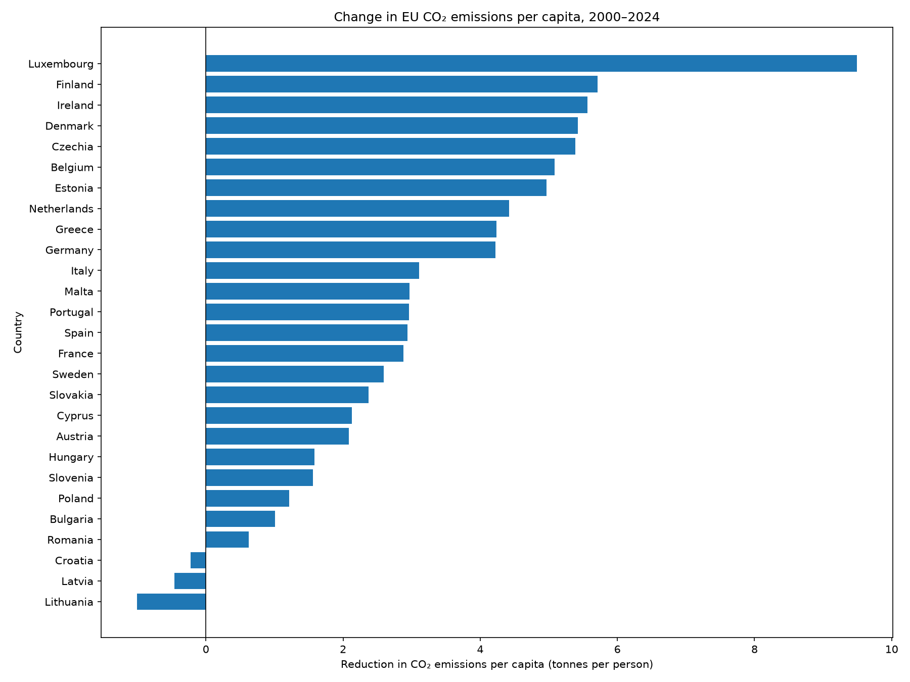

# co2-pipeline

**Question:** Which EU country has reduced its CO₂ emissions per person the most since 2000?

## Answer

We compared 2000 and 2024 for the 27 EU member states, using `co2_per_capita` (tonnes of CO₂ per person, excluding land-use change).

| Rank | Biggest cut in tonnes per person | Biggest cut in percent |
| --- | --- | --- |
| 1 | Luxembourg: 9.49 t | Denmark: 53.33 % |
| 2 | Finland: 5.71 t | Finland: 51.87 % |
| 3 | Ireland: 5.56 t | Malta: 48.09 % |



Bars to the right of 0 are reductions; bars to the left are increases (Croatia, Latvia, Lithuania).

**Which answer we would present:** We would present the cut in percent, with Denmark first, because it compares countries that started at very different levels. Luxembourg leads in tonnes mainly because it started extremely high (19.95 t per person in 2000): its population grew by 54 % while its total CO₂ fell by only 19 %, and much of its CO₂ comes from road fuel sold to cross-border workers and drivers in transit ([OECD](https://www.oecd.org/en/publications/environment-at-a-glance-indicators_ac4b8b89-en/full-report/component-32.html)). Finland is the only country in both top three, which makes it the most robust answer.

## How to run the pipeline

```bash
python3 -m venv .venv
source .venv/bin/activate
python -m pip install -r requirements.txt
python src/download.py      # downloads the pinned data into data/raw/ (only missing files)
python src/clean_co2.py     # writes data/processed/co2_eu.csv
python -m pytest            # runs the tests in tests/
python src/analyse.py       # prints both top-three lists and saves the chart in figures/
```

Activate `.venv` in every new terminal. `data/raw/` is not in Git; `download.py` creates it.

## Data and credits

- **Title:** CO₂ and Greenhouse Gas Emissions
- **Authors:** Our World in Data (Pablo Rosado, Hannah Ritchie, Max Roser, Edouard Mathieu, Bobbie Macdonald)
- **Source:** [github.com/owid/co2-data](https://github.com/owid/co2-data), pinned to commit `382ee6c662b0ece26e111f263b44c029afad7787` (2 June 2026); see also [ourworldindata.org/co2-and-greenhouse-gas-emissions](https://ourworldindata.org/co2-and-greenhouse-gas-emissions)
- **Licence:** [CC BY 4.0](https://creativecommons.org/licenses/by/4.0/)
- **Original sources of the columns we use** (column `source` in the codebook):
  - `co2`: Global Carbon Budget (2025), [globalcarbonbudget.org](https://globalcarbonbudget.org/)
  - `population`: Population based on various sources (2024), [ourworldindata.org/population-sources](https://ourworldindata.org/population-sources)
  - `co2_per_capita`: Global Carbon Budget (2025) and Population based on various sources (2024)
  - `country`, `year`: Our World in Data – Regions (2024); `iso_code`: International Organization for Standardization – Regions (2023)

Our World in Data asks users to cite both its dataset and the underlying sources; see [how to cite](https://ourworldindata.org/co2-and-greenhouse-gas-emissions#article-citation).